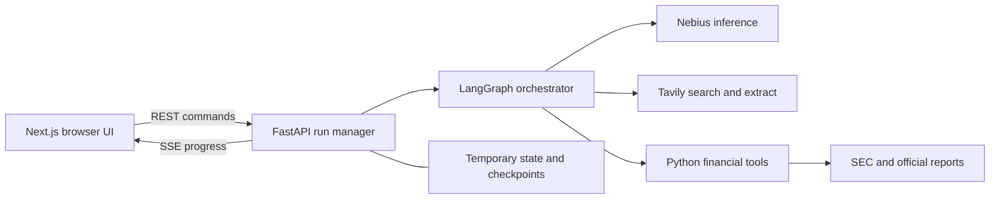

# Market Research Agent architecture

Engineering companion to the reviewed `market_research_agent_architecture_v1_1.docx`.
The user approved implementation and added gross margin and operating cash flow growth.
Changes to behavior should update this file and the handoff; retain the Word file as the
reviewed baseline, rather than silently claiming it reflects every subsequent code change.

## Scope

Personal course-submission MVP, adaptable later. Inputs are a configurable target company
and three competitors, or a target with automatic discovery. The first demo is Hershey HSY
versus Mondelez MDLZ, Kraft Heinz KHC, and General Mills GIS. Research scope and company
identities are never hardcoded. Warn about imperfect competitive overlap, and let users
confirm or replace peers before research. Optional geography/focus; news defaults to 90 days.

Include products/brands, differentiators, customers, positioning, geography, recent developments, a comparative briefing, five financial metrics, and supporting sources.
No accounts, report archive, follow-up chat, monitoring, PDF export, or public hosting in MVP1.

## Components

Next.js and TypeScript render the UI with Tailwind, shadcn/ui, and Recharts. FastAPI/Pydantic
owns the API, secrets, run manager, event stream, and validation. LangChain provides agent/tool
primitives; LangGraph coordinates typed state, fan-out, human interrupts, and bounded retries.
Nebius provides inference via its configured API/model; Tavily Search/Extract provide web
and news research. SEC EDGAR and official reports provide financial evidence. Python selects
facts and computes metrics. Exact integration dependencies and model ID remain to be pinned.

Use one localhost FastAPI worker and an in-process async task registry. Run IDs, opaque run
tokens, evidence, checkpoints, reports, budgets, and buffered events live in process memory.
Browser sessionStorage may hold only the temporary run handle for reload/reconnect. A restart
loses runs. Proposed expiry: paused and terminal runs expire after 60 minutes. Multi-worker
hosting requires durable storage and a job queue; public deployment also requires access control.

## Agent graph

Resolve/discover → human review interrupt → confirmed plan → per-company research and analysis
→ coverage/citation validation → bounded follow-up if necessary → synthesis → complete or partial.
Discovery verifies supplied peers and uses Tavily to suggest three peers when requested.
Research agents choose queries/extractions; analysis agents produce structured, cited findings.
The orchestrator coordinates and compiles. Financial tools are deterministic, not a model
inventing numbers. Agent roles are reused per company, not separate hosted services.

Maximum two concurrent company branches. Reducers merge branch results by stable company ID.
The confirmed scope is fixed for that run. Only one follow-up pass per company; failures in
one branch must preserve others. Budget/coverage decisions live inside deterministic graph
transitions, not an unbounded supervisor loop.

## Financial rules

Use consolidated annual SEC facts and verify concept mappings against official reports.
Retrieve four annual periods for three years of growth. Deduplicate by concept, unit,
period and filing; prefer the latest valid restatement available at the research cutoff.
Retain exact periods, currency, scale, form, filing date, accession, and source for all inputs.

| Metric | Definition |
| --- | --- |
| Revenue | Reported consolidated annual revenue/net sales |
| Revenue growth | 100 × (current revenue / prior revenue − 1) |
| Gross margin | 100 × reported gross profit / revenue |
| Operating margin | 100 × reported operating income / revenue |
| Operating cash flow growth | 100 × (current annual OCF / prior annual OCF − 1) |

Gross profit may be derived as revenue minus verified matching cost of sales. Use reported,
not adjusted, figures. OCF is net cash from operating activities, not free cash flow. Match
scope, currency and period for arithmetic. Growth needs positive prior revenue/OCF. Zero or
negative prior OCF yields `not_meaningful`, with both annual amounts and absolute change.
Negative current OCF and negative margins remain valid. Revenue denominators must be positive.

Do not mix annual, interim year-to-date, quarterly, or TTM facts. Label fiscal-year end dates
and differences; latest-year comparisons are not a common calendar period. Flag 52/53-week
years and documented scope/accounting changes. No automatic currency conversion. Unsupported
companies can still receive competitive research with financial fields unavailable. Missing
financial data must not prevent a usable partial briefing.

## Evidence and safety

Material factual findings refer to stored source IDs and supporting excerpts. Prefer official
company/filing sources; add reporting for context. Distinguish observation from inference.
Supported, conflicting, missing, and not-applicable are evidence statuses. Publication, event,
and retrieval dates differ; undated pages are not automatically recent news. Deduplicate
repeated stories. Do not treat citation presence as proof of entailment.

All credentials stay server-side. Render sources safely; retrieved text is untrusted evidence,
never instructions. Restrict outbound URLs/redirects against SSRF, including DNS/private IP
checks. SEC requests need an identifying User-Agent and conservative rate limits. Stockrow is
a UX reference, not an assumed financial data feed. Never expose raw upstream errors or secrets.

## API design

Prefix `/api/v1`. POST `/runs` creates and returns a run handle (202), supports Idempotency-Key.
GET `/runs/{id}` returns a status snapshot; POST `/runs/{id}/confirm` atomically accepts the
expected plan version and resumes once. GET `/runs/{id}/events` is fetch-based SSE with the
run token in a header, monotonically increasing IDs, Last-Event-ID replay, and snapshot fallback.
GET `/runs/{id}/report` returns results or 409 while pending. POST `/runs/{id}/cancel` is repeatable.
GET `/health` and `/ready` expose safe local health/configuration status without paid calls.

States: queued, resolving, awaiting_review, researching, validating, synthesizing, completed,
partial, failed, cancelled, expired. Reject conflicting creation keys or stale confirmation
with 409; invalid input with 422; unknown/unauthorized handles with generic 404; capacity with
429. An authorized expired handle can return 410 during a tombstone window. Disconnecting SSE
does not cancel a run. No hidden model reasoning is streamed.

## Reliability and engineering defaults

Proposed limits to validate: one active run, two company branches, ten minutes active execution
excluding approval, 24 search attempts, 20 extracted URLs, estimated 60 Tavily credits, 28 model
calls, 60k cumulative input tokens and 12k output tokens. Retries count against the same limits.
Reserve before dispatch; these estimates do not guarantee provider billing. Honor Retry-After,
use finite timeout/backoff, do not retry invalid credentials, and permit one schema repair.
On exhaustion, compile useful partial evidence. Cancellation stops new work and discards late results.

Logs capture IDs/stages, safe errors, duration, usage, and coverage, not secrets or full prompts.
LangSmith remains optional and disabled by default. Test core invariants with mocks and use a
small explicit live integration suite. Reconcile all five metrics for the four demo companies
against filings. Target: sourced usable workflow in under 15 minutes, not yet measured.

## References

- [Course handout](https://docs.google.com/document/d/1ixizY2Bd-FUkT6nhYPNRVbtP-LFGqUWHP9tB9HgcH6Q/edit)
- [LangGraph interrupts](https://docs.langchain.com/oss/python/langgraph/interrupts)
- [Nebius examples](https://github.com/nebius/token-factory-cookbook)
- [SEC APIs](https://www.sec.gov/search-filings/edgar-application-programming-interfaces)
- [Tavily credits](https://docs.tavily.com/documentation/api-credits)
- [Stockrow layout reference](https://stockrow.com/compare/HSY-vs-MDLZ)

## Phase 3 implementation decisions (October 31, 2026)

The local API uses the described single-process task registry and LangGraph in-memory
checkpoints, storing JSON-safe graph state. Identity resolution searches for official
websites and uses SEC ticker identity when available; human review remains required.
A rejected/replaced scope is handled by cancel and a fresh request. Non-SEC names can
receive research with financial coverage explicitly unavailable. Automatic discovery is
implemented but only mocked/offline behavior is established; no live discovery demo yet.

Company work is limited to two concurrent branches. SEC uses a shared adapter plus
thread/async locks so synchronous requests remain serialized after async cancellation.
Research uses three deterministic field-specific searches per company (portfolio/strategy,
customers/geography, and dated news), extracts at most one relevant URL
per group, and performs one focused coverage follow-up with at most one more extraction. Structured claims require an exact
supporting quote in a source owned by that company. The model's interpretation remains
labeled inferred; this lexical validation does not establish entailment. Recent claims
require a publication timestamp within the requested lookback; event dates are not inferred.
The comparative briefing compiles already-cited positioning and differentiation findings;
a separate generative synthesis agent is deferred until it improves evidence quality.

Budgets reserve before every dispatch and retry, including full output allowances and
conservative UTF-8 byte estimates for input. Reservations are intentionally not refunded;
reported model usage is separate. This can yield partial reports below actual provider
token limits. One retry handles transient failures; a schema failure permits one repeated
structured request. There is no unbounded repair loop. Retry-After above 30 seconds is
not retried early. Timeout/cancellation prevents new work and discards late results, but
cannot undo already-dispatched synchronous HTTP charges. Partial financial/evidence
results are retained before qualitative work completes.

Lifecycle and replay behavior are covered by API/graph tests; actual external socket
and browser reconnect behavior remain Phase 4 validation. The four-company paid API run
is real but partial: details are in `validation/phase3-live-summary.json`. No complete
qualitative report or UI execution is claimed. Run creation idempotency keys should be
unpredictable, since this local unauthenticated creation endpoint has no user namespace.

## Qualitative retrieval follow-up (October 31, 2026)

Company branches receive equal fixed shares of the remaining run budget after identity
resolution. Both the company share and global limits are checked before each dispatch;
retries count against both. Unused shares are not borrowed by earlier branches. Three
initial searches plus one follow-up per company use at most 20 searches, including four
identity searches; discovery/retries can reduce available follow-up capacity.

The analysis context selects a relevant literal window per field rather than the first
six source prefixes. Follow-up analysis receives only unresolved fields and merges its
findings with successful earlier findings. Extraction keeps search publication metadata,
titles and source provenance, and retains search text alongside extracted text. Publication
parsing accepts explicit ISO/date-only/RFC dates and labeled page publication metadata;
it never substitutes retrieval or event dates. News requests include explicit start/end
publication filters; local validation also rejects old/future evidence before context
selection and claim acceptance.

The user removed pricing from required coverage because these companies sell unlike
products. Default research no longer searches for pricing or emits missing-pricing fields.
Legacy pricing claim validation remains available internally for an explicitly scoped
future comparison; no price ranking or unit-price comparison is inferred. Official domain classification is
based on the human-reviewed website host, with SEC separately classified as filings.

The final run after the scope change covered 23/24 required qualitative fields and
60/60 reconciled financial values in 38.67 seconds. Only KHC recent developments remained
unsupported. See `validation/phase3-retrieval-summary.json`; the seven-field earlier run
is historical. Completion means validated coverage under the six-field scope, not an
independent proof of entailment. A live news parameter probe also verified that Tavily
accepts explicit date bounds when `days` is omitted (the two forms cannot be combined).

## Phase 4 web implementation (October 31, 2026)

`apps/web` is the local Next.js App Router/TypeScript frontend, using Tailwind 4,
a shadcn-style Radix Slot/CVA button and Recharts. A fixed-origin Route Handler streams
FastAPI responses without collecting SSE bodies; it forwards only the run token,
idempotency key, event cursor and content type. Backend credentials remain outside
Next.js. The frontend port and API port are separate localhost processes, one API worker.

The browser saves only the temporary handle in sessionStorage. It fetches the snapshot,
opens fetch SSE with header authorization, frames chunked/CRLF events, retries disconnects
with bounded backoff, and sends Last-Event-ID. Replay advances the cursor without regressing
a newer snapshot. Reload replays from zero because the cursor is not persisted. Heartbeats
maintain the connection; 45 seconds of silence reconnects. REST calls have 20-second limits.
Disconnecting or leaving the page does not cancel a run; the explicit cancel action does.

The UI requires approval of the exact plan version and uses cancel/new request for edits.
Overall stages are displayed; per-company progress is not invented because the API does
not publish it. Completed/partial and retained cancelled reports share evidence views.
All five metrics have selectable charts, companion tables, exact periods/filing inputs,
not-meaningful breakdowns and missing reasons. Each currency has its own chart; unsupported
values remain null. Qualitative evidence status and inferred basis remain visible.

Browser tests against an external offline Uvicorn exercise complete/partial, approval,
reload, network interruption/replay cursor, cancellation, expiry, unknown handles,
capacity/configuration failures, and mobile layout. A separate single paid browser run
verified production Next.js → external Uvicorn → actual providers; it returned partial,
60 available financial values and 23/24 required qualitative fields (KHC customers missing).
See `validation/phase4-browser-live-summary.json`. This is not a complete live-report claim
or independent new reconciliation. Deterministic complete-report tests are explicitly offline.

## Phase 4 workspace redesign (November 1, 2026)

The user approved adapting the supplied UI design document after a scope review. The
frontend now uses a compact setup sidebar and separate Setup, Run and Briefing views.
Wide-screen research has a pipeline and review/briefing preview; results expand across
the main canvas. Mobile has bottom navigation and sequential views. No marketing hero,
project library, account controls, exports, pricing comparisons or confidence scores were added.

Report sections are Overview, Companies, Comparison, Financials, Recent developments and
Sources. Overview groups existing cited positioning/differentiation by company without
inventing synthesis. Comparison aligns the six required fields across four companies.
Financials starts with a five-row latest-year comparison, then annual charts; all 60 annual
values remain in an expandable table. Dates/currencies and missing/not-meaningful values
remain explicit. A native modal side drawer shows source excerpts or exact Python metric
values and official filing inputs. Sources are searchable/filterable, with collected and
cited evidence distinguished. Warnings are collapsed into comparability notes and missing
fields are also shown beside their companies. No generated risk/opportunity synthesis added.

The existing API snapshot/SSE payload has two additive fields:
- `company_progress`: mapping from company ID to current `company_id`, `stage`, optional
  `sources_collected`, `search_attempts`, `supported_fields`.
- `activity`: the latest 40 company event records, each with UTC `at` timestamp.

`company_progress` SSE events use the same snapshot envelope, header token and monotonic
sequence as status events, so reconnect/replay and fallback retain this state. Stages are
queued, financials, collecting, analyzing, followup, completed, partial or failed. Counts
are collected unique sources and reserved search attempts, not claims of analysis quality
or provider billing. Completed/partial company status is computed from required findings
and financial coverage. Cancelled/terminal runs reject late events. No raw queries,
provider bodies, prompts or hidden model reasoning are included. Existing request, plan
and report contracts are unchanged; richer progress is additive and optional in the client.

Company retry/source exclusion/mid-run editing, company autocomplete, source preference
switches, saved user edits, scoring and new generative executive analysis remain outside
this change. Scope replacement still requires cancel/new request. No new paid validation
run was needed; the new UI/events are exercised with the actual API/graph over external
Uvicorn using explicitly labeled offline evidence. Earlier provider evidence remains historical.
